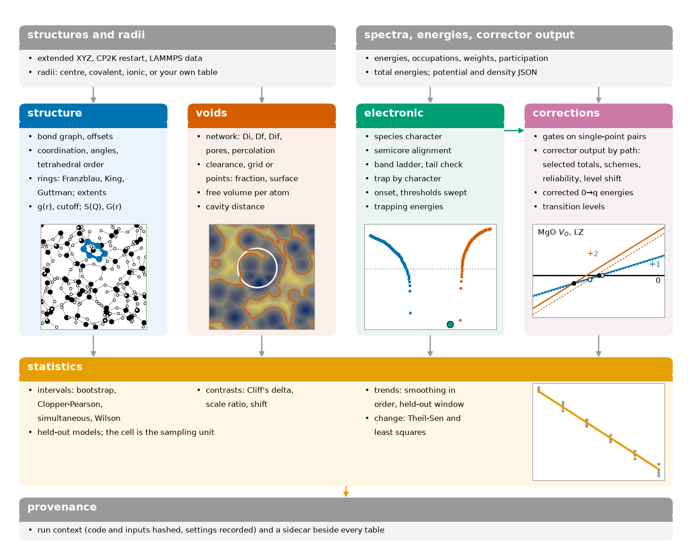

# vfa: Vitriflow enhanced analysis

Structure, total scattering, voids, electronic spectra, finite-size corrections, statistics and provenance for amorphous periodic
network structures and charge trapping in them.

    pip install -r requirements.txt
    pip install .
    pytest -q
    bash demo/run.sh            # example data -> tables in demo/out/, figures in demo/out/ and demo/figures/ (a few minutes)

Start with the [tutorial](docs/tutorial.md); defaults and options are in [docs/conventions.md](docs/conventions.md). Record the radii per species and the bond cutoff per bonding pair with the results.

*The workflow. Corrections panel: the oxygen vacancy in MgO from the corrector's example, formation energy against the Fermi
level across the gap (neutral = 0), dashed uncorrected, solid with the static LZ correction, dots the transition levels.*

*The void space of one example cell.*

    vfa/io             extended XYZ, LAMMPS data; CP2K restart, output, projected densities of states, Mulliken blocks,
                       trajectory energies, cube headers
    vfa/structure      cell geometry; bond graph with image offsets; rings (Franzblau, King, Guttman); pair correlations,
                       running coordination, first minimum; total scattering S(Q), G(r), first sharp diffraction peak; angles,
                       tetrahedral order, planarity
    vfa/voids          radii conventions; clearance by grid or sampling, accessible fraction, void surface; pore network:
                       included and free spheres, percolation, pores and throats; free volume at each atom
    vfa/electronic     spectra as tables: species character, semicore alignment, band ladder, trap by character,
                       delocalisation onset, internal depth; trapping energies; Mulliken tracking
    vfa/corrections    gates on a pair of single points; the reader of the corrector's output; corrected 0 -> q energies,
                       transition levels
    vfa/stats          bootstrap, exact, Clopper-Pearson and Wilson intervals, simultaneous bands; effect sizes; trends
                       along an ordering variable; held-out models
    vfa/provenance.py  run context, sidecars, CSV and Parquet writers
    example/           make_example.py and data/: synthetic network glasses, one synthetic trapping event per cell
    demo/              the demo scripts and run.sh; data/: the corrector's MgO example, for fig00 and fig03
    tests/             pytest: closed-form lattices, brute-force references, synthetic files

The corrections part reads the output of
[cp2k-charge-corrections](https://github.com/Olsson-Materials-Modelling/cp2k-charge-corrections) 0.8.0 (schema 4.0). Licence: MIT
(Olsson Materials Modelling).

References for the methods named in the code and in the conventions:

- radii: B. Cordero et al., Dalton Trans. 2832-2838 (2008), <https://doi.org/10.1039/b801115j>; R. D. Shannon, Acta Cryst. A32,
  751-767 (1976), <https://doi.org/10.1107/S0567739476001551>
- rings: D. S. Franzblau, Phys. Rev. B 44, 4925-4930 (1991), <https://doi.org/10.1103/PhysRevB.44.4925>; S. V. King, Nature 213,
  1112-1113 (1967), <https://doi.org/10.1038/2131112a0>; L. Guttman, J. Non-Cryst. Solids 116, 145-147 (1990),
  <https://doi.org/10.1016/0022-3093(90)90686-G>
- clearance sampling: I. M. Sobol', USSR Comput. Math. Math. Phys. 7, 86-112 (1967), <https://doi.org/10.1016/0041-5553(67)90144-9>
- pore network: D.-S. Kim, Y. Cho and D. Kim, Comput.-Aided Des. 37, 1412-1424 (2005), <https://doi.org/10.1016/j.cad.2005.02.013>
- total scattering: T. E. Faber and J. M. Ziman, Phil. Mag. 11, 153-173 (1965), <https://doi.org/10.1080/14786436508211931>; D. A.
  Keen, J. Appl. Cryst. 34, 172-177 (2001), <https://doi.org/10.1107/S0021889800019993>; E. Lorch, J. Phys. C 2, 229-237 (1969),
  <https://doi.org/10.1088/0022-3719/2/2/305>
- electronic: R. S. Mulliken, J. Chem. Phys. 23, 1833-1840 (1955), <https://doi.org/10.1063/1.1740588>; correction schemes: the
  corrector's README
- statistics: C. J. Clopper and E. S. Pearson, Biometrika 26, 404-413 (1934), <https://doi.org/10.1093/biomet/26.4.404>; E. B.
  Wilson, J. Am. Stat. Assoc. 22, 209-212 (1927), <https://doi.org/10.1080/01621459.1927.10502953>; E. L. Korn and B. I. Graubard,
  Survey Methodology 24, 193-201 (1998); H. Theil, Proc. K. Ned. Akad. Wet. 53, 386-392, 521-525 and 1397-1412 (1950); P. K. Sen,
  J. Am. Stat. Assoc. 63, 1379-1389 (1968), <https://doi.org/10.1080/01621459.1968.10480934>; N. Cliff, Psychol. Bull. 114,
  494-509 (1993), <https://doi.org/10.1037/0033-2909.114.3.494>; H. B. Mann and D. R. Whitney, Ann. Math. Stat. 18, 50-60 (1947),
  <https://doi.org/10.1214/aoms/1177730491>; M. B. Brown and A. B. Forsythe, J. Am. Stat. Assoc. 69, 364-367
  (1974), <https://doi.org/10.1080/01621459.1974.10482955>; B. P. Welford, Technometrics 4, 419-420 (1962),
  <https://doi.org/10.1080/00401706.1962.10490022>
