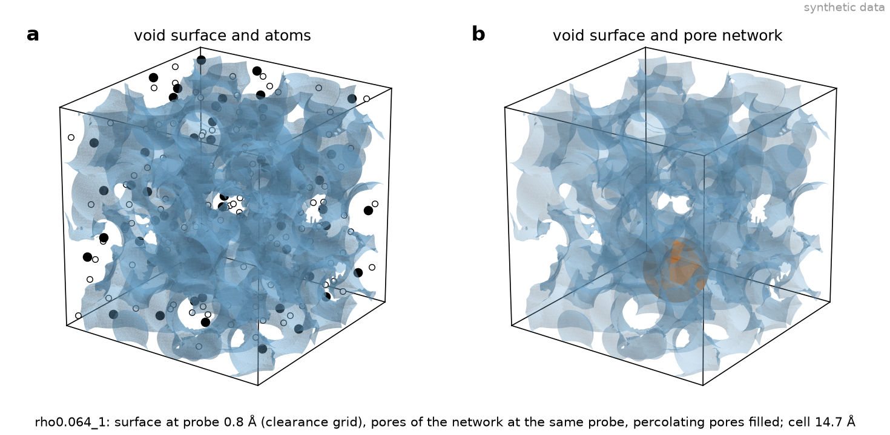

# vfa: Vitriflow enhanced analysis

Analysis of amorphous network structures and of charge trapping in them: structure, voids,
electronic spectra, finite-size corrections, statistics and provenance, each with its modes and caveats stated.

    pip install -r requirements.txt
    pytest -q
    bash demo/run.sh            # example data -> tables and figures in demo/out/ (a few minutes)

Two settings enter: the radii per species, saved beside the data, and the bond cutoff, measured from the pair correlation.

```python
from vfa.voids.radii import Radii
from vfa.structure.rdf import ensemble_rdf, first_minimum
radii = Radii.covalent(symbols); radii.save('radii.json')          # or Radii.ionic, Radii.centre, or your own table
r, g = ensemble_rdf(cells, ('Si', 'O')); cutoff = first_minimum(r, g)['minimum_A']
```


*The workflow: inputs above the part that reads them, the four parts with what each produces and a picture of it, the shared
statistics, the provenance.*


*The void space of one example cell: the surface at the probe radius from the clearance grid, with the atoms and with the
Voronoi pore network at the same probe, percolating pores filled.*

The steps: [docs/tutorial.md](docs/tutorial.md). What each convention assumes, where it fails, how to check it:
[docs/conventions.md](docs/conventions.md).

    vfa/io             extended XYZ, LAMMPS data, CP2K restart, output, projected densities of states, Mulliken blocks
    vfa/structure      cell geometry; bond graph with image offsets; rings (Franzblau, King, Guttman; capped or converged; extents);
                       pair correlations, running coordination, first minimum; angles, tetrahedral order, planarity
    vfa/voids          radii conventions with their data; clearance by grid or sampling, accessible fraction, void surface,
                       convergence checks; Voronoi network: largest included and free spheres, percolation, pores and throats;
                       free volume at each atom, distance to the nearest pore
    vfa/electronic     spectra as tables: species character, semicore alignment, band ladder, tail control, trap by character,
                       delocalisation onset, internal depth; trapping energies; Mulliken tracking
    vfa/corrections    gates on a pair of single points; the labelled schemes of cp2k-charge-corrections (external)
    vfa/stats          bootstrap and exact intervals, simultaneous bands, Wilson; Cliff's delta, scale ratio; smoothing in order
                       with a held-out window, straight-line change by Theil-Sen and least squares; held-out models
    vfa/provenance.py  run context, sidecars, CSV and Parquet writers
    example/           make_example.py and data/: synthetic network glasses with one synthetic trapping event per cell
    demo/              schematic.py, analyse.py, modes.py, electronic.py, trends.py, plot.py, style.py, run.sh
    tests/             pytest: closed-form lattices, a known spectrum, exact intervals

The corrections part reads the output of [cp2k-charge-corrections](https://github.com/Olsson-Materials-Modelling/cp2k-charge-corrections).
Licence: MIT (Olsson Materials Modelling).
