# Tutorial

Steps 1 to 9 run on the example data from the repository root; 10 to 12 take your own files. Defaults and options:
[conventions.md](conventions.md).

## 1. Structures and radii

```python
from pathlib import Path
import numpy as np
from vfa.io.extxyz import read_structure_files
from vfa.voids.radii import Radii
names, cells = read_structure_files(Path('example/data/structures'))      # every .extxyz or .xyz file, last frame: (symbols, positions, cell)
radii = Radii.load('example/data/radii.json')                              # or Radii.covalent(symbols), Radii.ionic(symbols), Radii.centre(symbols)
```

Other readers: `vfa.io.cp2k.read_restart`, `vfa.io.lammps.read_lammps_data` (Å; the file's unit if the title names none or lj).
[Radii](conventions.md#radii).

## 2. The bond cutoff, measured

```python
from vfa.structure.rdf import ensemble_rdf, first_minimum
r, g = ensemble_rdf(cells, ('A', 'B'), r_max=6.0, n_bins=600)
fm = first_minimum(r, g, search=(1.0, 4.5)); assert fm['resolved']; cutoff = fm['basin_middle_A']
```

[Bond graph](conventions.md#bond-graph).

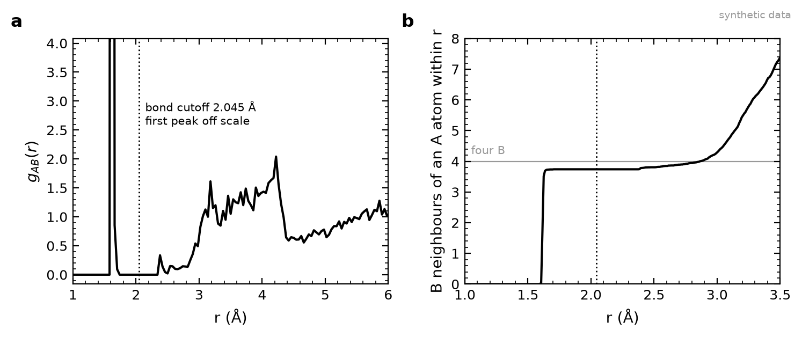
*The A-B pair correlation of the five cells made like the example cell, with the cutoff measured over all 30 cells, and the mean number of B neighbours of A within r (grey: four).*

## 3. Bond graph and local geometry

```python
from vfa.structure.graph import bond_graph, coordination, bond_vectors, angles, tetrahedral_order, planarity
i = len(cells) // 2; sym, pos, cell = cells[i]                                  # one cell: the one the figures show
edges, offsets, lengths = bond_graph(sym, pos, cell, {('A', 'B'): cutoff})    # one entry per species pair that bonds
z = coordination(len(sym), edges); vec = bond_vectors(pos, cell, edges, offsets)
theta = angles(vec, np.flatnonzero(sym == 'A'))                                # B-A-B angles
q = tetrahedral_order(vec, range(len(sym))); p = planarity(vec, range(len(sym)))
```

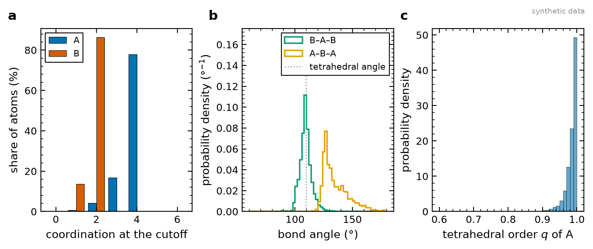
*Coordination by species at the cutoff, the bond angles and the tetrahedral order of A, over all 30 cells.*

## 4. Rings

```python
from vfa.structure.cell import shortest_vector
from vfa.structure.rings import rings, ring_sizes, ring_extents
prim = rings(len(sym), edges, offsets, max_length=24, criterion='primitive', images=True)   # or 'king', 'guttman'
keep = ring_extents(prim, pos, cell) < np.linalg.norm(shortest_vector(cell))
sizes = ring_sizes([r for r, k in zip(prim, keep) if k])                                     # network-former units
```

[Rings](conventions.md#rings).

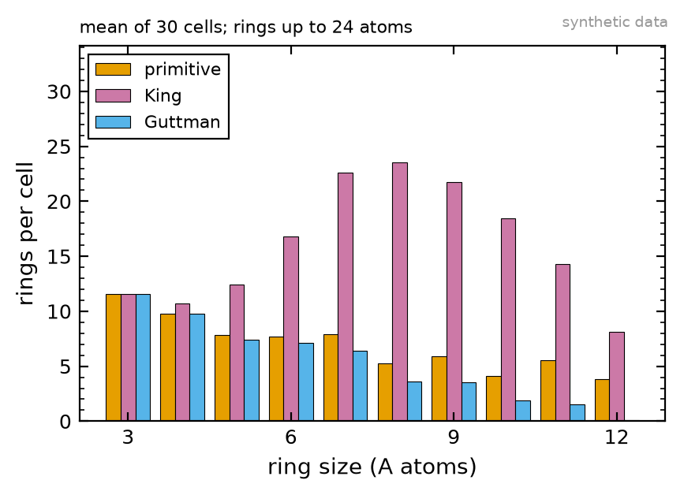
*Rings per cell by size under the three criteria, the mean of the 30 cells; size in A atoms, rings up to 24 atoms.*

## 5. Total scattering

```python
from vfa.structure.scattering import direct_partials, transform_partials, ensemble_direct, concentrations, total_sq, fsdp
b = {'A': 1.0, 'B': 1.0}; c = concentrations(sym)                                           # your scattering lengths, or f(Q) callables
q, S_ab, m = direct_partials(sym, pos, cell, q_max=20.0, dq=0.1); F, S = total_sq(q, S_ab, c, b)
F_t, S_t = total_sq(q, transform_partials(sym, pos, cell, q, window='lorch'), c, b)
same = [x for n, x in zip(names, cells) if n.split('_')[0] == names[i].split('_')[0]]   # the five cells made like cell i
qe, Se, ce = ensemble_direct(same, 20.0, dq=0.2)
peak = fsdp(qe, total_sq(qe, Se, ce, b)[1], window=(3.5, 6.5))                              # the example has no first sharp diffraction peak: this finds its main peak
```

[Total scattering](conventions.md#total-scattering).

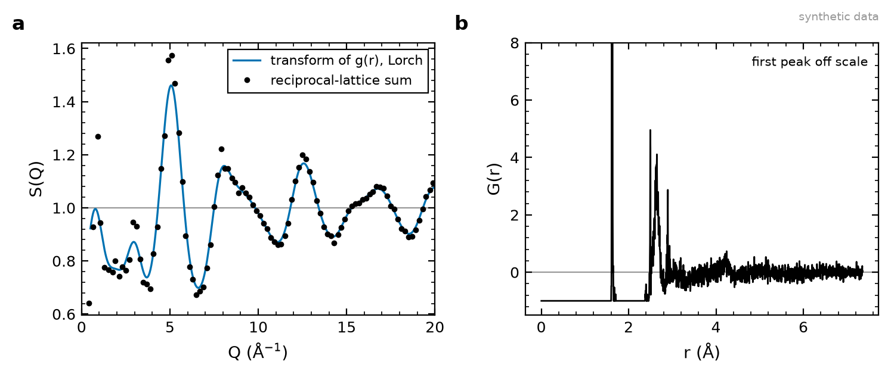
*S(Q) of the five cells made like the example cell by the reciprocal-lattice sum and by the transform, and G(r), equal weights.*

## 6. Clearance: grid and pointwise

```python
from vfa.voids.clearance import clearance_field, sample_clearance, accessible_fraction, probe_sweep, clearance_statistics, sampling_convergence, grid_convergence
C, n = clearance_field(pos, cell, radii.of(sym), dx=0.15)
s = sample_clearance(pos, cell, radii.of(sym), n=8192, sampler='sobol')
rows = probe_sweep(C, n, cell, probes=(0.3, 0.5, 0.8, 1.0, 1.2))              # fraction, volume, surface, specific surface
stats = clearance_statistics(s)
grid_convergence(pos, cell, radii.of(sym), probe=0.8); sampling_convergence(pos, cell, radii.of(sym), probe=0.8)
```

[Void space](conventions.md#void-space).

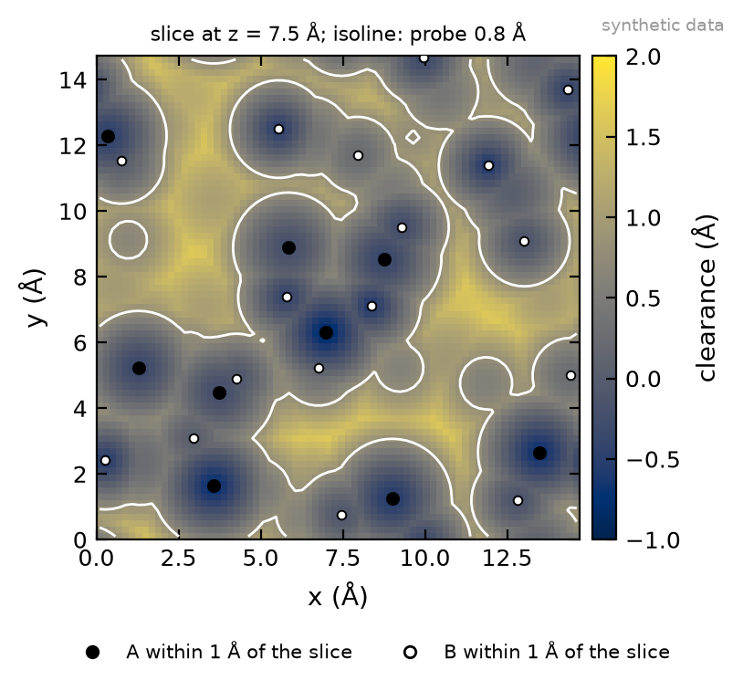
*The clearance of the example cell in a slice, with the isoline at the probe radius.*

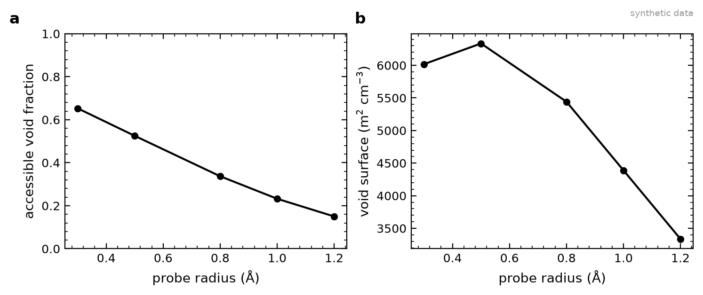
*Accessible fraction and void surface of the example cell against the probe radius.*

## 7. The pore network

```python
from vfa.voids.network import voronoi_network, descriptors, pore_network, percolating_edges
net = voronoi_network(pos, cell, radii.of(sym))
d = descriptors(net)                        # Di_A, Df_A, Dif_A (diameters), cavity_to_neck, exact, complete, percolates (None: undecided)
pores = pore_network(net, probe=0.8)        # pores and throats, which pores percolate (decided False: left open)
mask, thr = percolating_edges(net)          # the percolating thread at the free-sphere radius
```

## 8. The void space from each atom

```python
from vfa.voids.sites import atom_free_volume, cavity_distance
fv = atom_free_volume(C, n, cell, pos, radii.of(sym), probe=0.8)
cd = cavity_distance(pos, cell, pores['pore_xyz'])
```

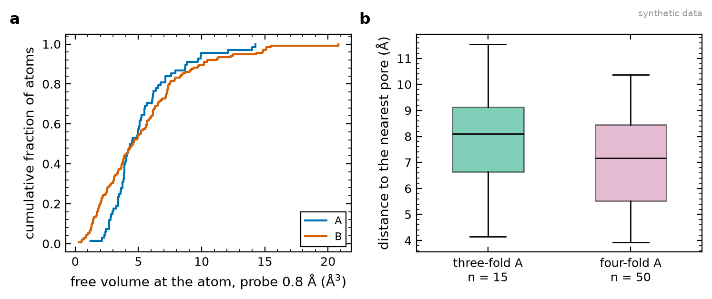
*Free volume per atom by species, and the cavity distance of three- and four-fold A, in the example cell.*

## 9. Reading a spectrum

```python
from vfa.electronic.spectrum import character, occupied_count, semicore_reference, align, band_ladder, tail_spread, bulk_character, trap_level, delocalisation_onset, internal_depth
N = len(sym); z = np.load(f'example/data/spectra/{names[i]}.npz'); E, occ, atoms = z['charged_energy_eV'], z['charged_occupation'], z['charged_atoms']
f = character({'A': z['charged_weight_A'], 'B': z['charged_weight_B']}, 'A'); n = occupied_count(occ)
k, ref = semicore_reference(E, n); E = align(E, ref)
ladder = band_ladder(E, n); tail = tail_spread(E, n)
trap = trap_level(E, f, n, bulk_character(f, n)['valence'])
onset = delocalisation_onset(E, atoms, n, N, fractions=(5, 4, 3)); depth = internal_depth(E, atoms, n, N)
```

`atoms`: the participation number of each state. From CP2K, `vfa.io.cp2k.read_spectrum(folder)` returns the energies, occupations
and weights per kind (add the kinds of one species); `spin='ALPHA'` by default, `None` for a restricted run. With OT, use empty
states only if `read_output(log)['unoccupied_converged']`. [Electronic spectra](conventions.md#electronic-spectra).

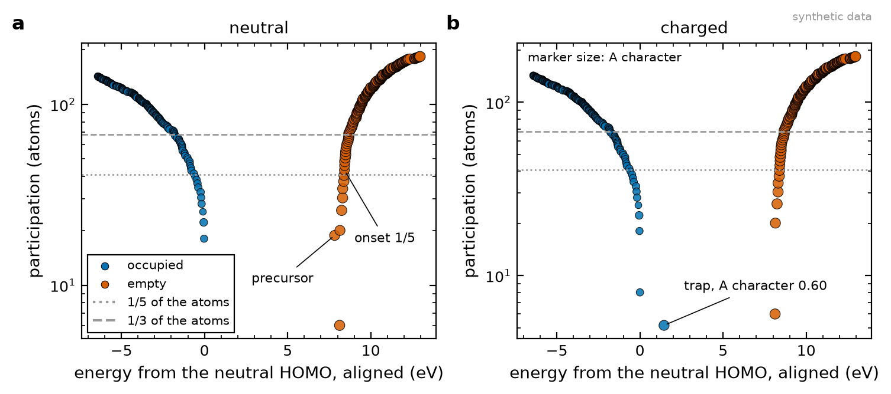
*The example cell before and after the electron is added: participation against energy, marker size the A character. a: the lowest empty state (precursor) and the 1/5 onset; b: the trap by A character. Dotted and dashed: 1/5 and 1/3 of the atoms.*

## 10. Corrections

```python
from vfa.io.cp2k import read_output
from vfa.corrections.gates import gate_pair
from vfa.corrections.schemes import summarise, corrected_formation_energy, transition_levels
bad = gate_pair(read_output(charged_log), read_output(neutral_log))           # CP2K outputs: the charged run, the neutral at its geometry; [] if both pass
row = summarise(f'example/data/corrections/{names[i]}.relaxed.potential.json', f'example/data/corrections/{names[i]}.relaxed.density.json')
e_f = corrected_formation_energy(e_f_raw, row)                              # e_f_raw: uncorrected formation energy of charge -1 at E_F = 0, relative to the neutral
levels = transition_levels({0: 0.0, -1: e_f})
```

[Finite-size corrections](conventions.md#finite-size-corrections).

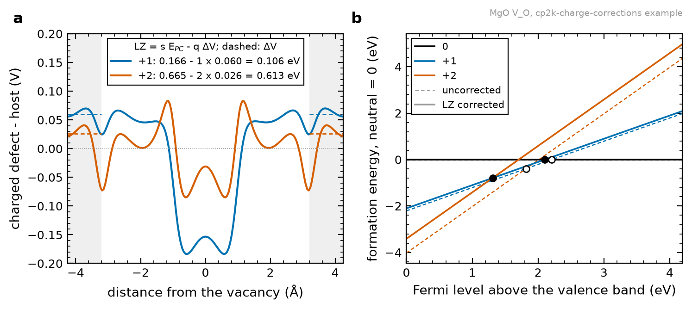
*The corrector's MgO oxygen vacancy. a: charged defect minus host, mean of the three axes, far region shaded; dashed, the alignment ΔV each LZ value subtracts (s: LZ scale, E_PC: point-charge energy). b: formation energies, transition levels uncorrected (open) and LZ corrected (filled).*

## 11. Statistics on your cells

```python
from vfa.stats.intervals import percentile_bootstrap, bounded_prevalence, influence_mean, maxt_simultaneous
from vfa.stats.trends import positions, held_out_window, smooth_in_order, linear_change
from vfa.stats.contrasts import cliff_delta_interval
# y: one value per cell; x: the column you order the cells by; g: a group label per cell; k of m: counted sites per cell; in_a, in_b: two groups
mean = percentile_bootstrap(y)                                                    # estimate, lower, upper
share = bounded_prevalence(k / m, sites=m)                                        # a share of sites, its interval from the site counts
labels = np.unique(g); est = np.array([y[g == u].mean() for u in labels]); inf = np.zeros((len(y), len(labels)))
for j, u in enumerate(labels): inf[g == u, j] = influence_mean(y[g == u])[1]
band = maxt_simultaneous(inf, est, groups=g)                                      # every group mean at once
o = np.argsort(x, kind='stable'); w = held_out_window(y[o], widths=(1, 2, 4, 8, 16, 32))   # the smoothing the cells support
curve = smooth_in_order(y[o], np.arange(len(y)), w['chosen'])
q, _ = positions(x); change = linear_change(x, y, q[0], q[1])                     # Theil-Sen and least squares, with intervals
contrast = cliff_delta_interval(y[in_a], y[in_b])                                 # Cliff's delta between any two groups of cells
```

[Statistics](conventions.md#statistics).

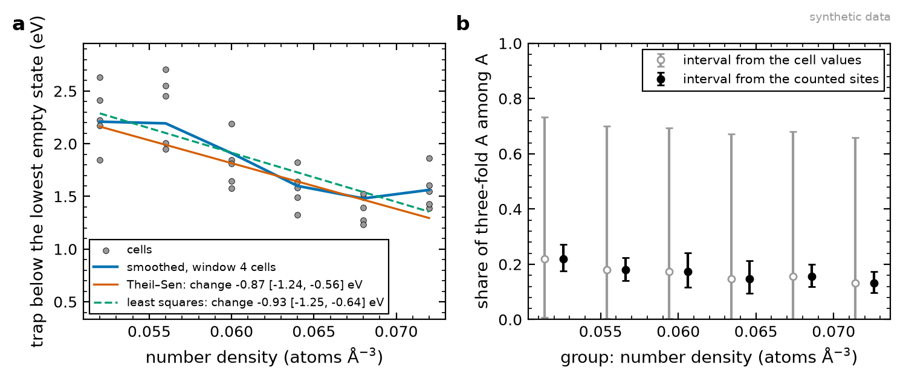
*a: the trap depth of each example cell against its number density; the smoothed curve at its held-out window and the change by both straight-line fits. b: the share of three-fold A among A in each set of five cells, its interval from the 5 cell values (grey) or from the 340 sites (black).*

## 12. Provenance

```python
from vfa.provenance import RunContext, write_csv
ctx = RunContext().with_config(dict(cutoff_A=cutoff, radii=radii.name, radii_A=radii.table)).with_inputs(paths)   # paths: the files you read
write_csv(table, 'out/cells.csv', ctx)                                        # table: your results; writes cells.csv and cells.csv.meta.json
```

## 13. The demo

`demo/analyse.py` runs steps 2 to 8 on every cell, `demo/modes.py` the modes side by side, `demo/electronic.py` step 9 with
`summarise` and `corrected_formation_energy`, `demo/statistics.py` step 11, `demo/plot.py` fig01 to fig12 and `demo/schematic.py`
fig00. `bash demo/run.sh remake` first regenerates the example data (about 10 minutes); `PYTHON` selects the interpreter.

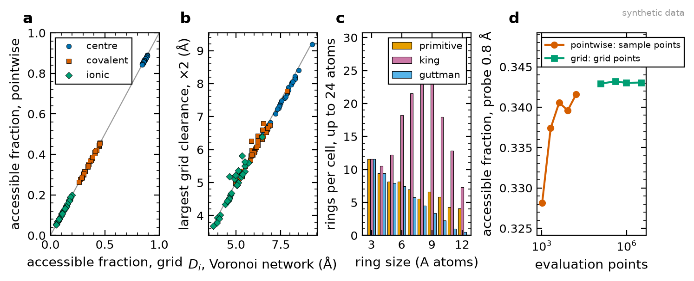
*The modes side by side, colours the radii conventions: a, grid against pointwise accessible fraction; b, the largest included sphere by the network and on the grid (twice the largest clearance); c, convergence of one cell at probe 0.8 Å.*

## 14. Your own material

Point `read_structure_files` at your folder, give `Radii` your species and measure each bonding pair's cutoff (step 2). To run
the demo on your cells, set in `demo/analyse.py` and `demo/modes.py` the cells table (`cell`, `number_density`), your species in
place of `'A'` and `'B'`, the probe radii, grid spacing and ring cap. `demo/electronic.py` reads spectra, `events.csv` and
corrector JSON laid out as in `example/data`; `demo/statistics.py` takes its columns from `ORDER`, `GROUP` and `VALUE`.
